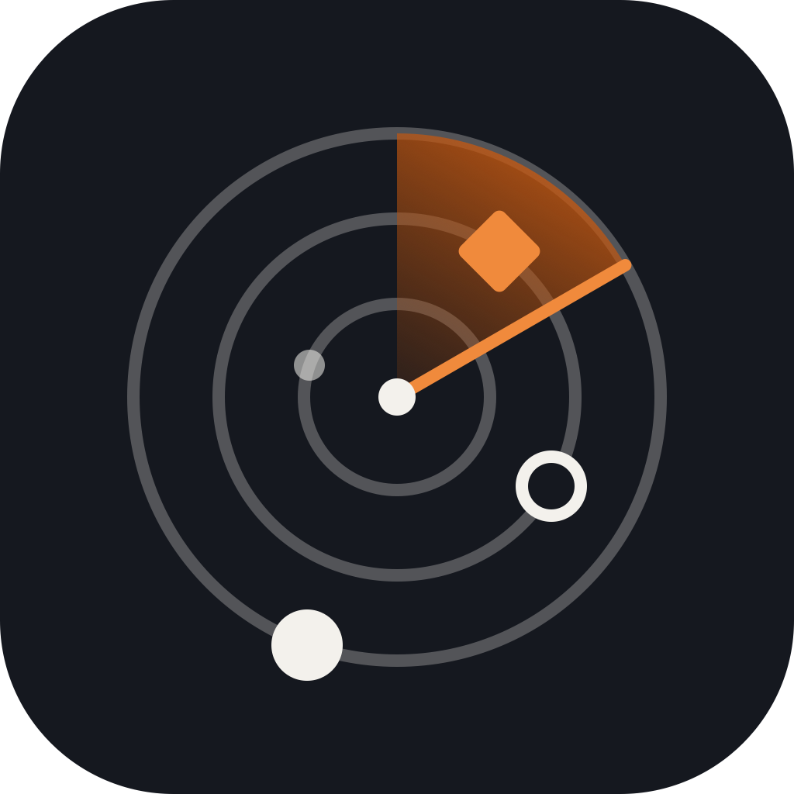

# Sitzungsradar

[](https://github.com/sdaum1909/sitzungsradar/releases/latest)
[](LICENSE)


Ein Panel für Claude Code, das dir alle gerade laufenden Sitzungen zeigt, über alle Projekte hinweg.
Wer mit Claude anfängt, hat schnell drei, vier Sitzungen offen und verliert den Überblick: Welche
arbeitet noch? Welche wartet seit zehn Minuten auf mich? Wo hängt eine Freigabe? Das Sitzungsradar
beantwortet das auf einen Blick, im Terminal und in der Desktop-App. Jede Sitzung steht mit ihrem
Namen da, mit dem Abschnitt, in dem sie gerade arbeitet, und mit einem Knopf, der dich direkt hineinbringt.

Ohne Kosten, ohne Konto, Quelltext offen unter MIT-Lizenz. Ein Werkzeug von
[BuildMySoftware](https://buildmysoftware.de).

*English summary [below](#in-english).*

## Was du siehst

```
Sitzungsradar
4 Sitzungen · 1 braucht dich · 1 wartet · 1 arbeitet

◆ Anmeldeseite bauen                              [ Öffnen ]
  fragt dich (AskUserQuestion) · shop-relaunch › login · opus-5-5
  Abschnitt: Formular · Schritt 2/5: Tests schreiben

● Rechnungsmaske                                  [ Öffnen ]
  arbeitet seit 3 min · Bash · rechnungs-app › neue-maske · sonnet-5-5
  Abschnitt: Umsetzung · Schritt 3/4: Eingabefelder prüfen
  „Bau mir die Eingabemaske für Rechnungen“

○ Blog-Layout  (diese Sitzung)
  wartet auf dich seit 2 min · website › blog · opus-5-5
  Abschnitt: Feinschliff · Stand: Das neue Layout ist online.

· notizen
  ruhig seit 40 min · haiku-5-5
```

*Beispiel mit erfundenen Projekten.*

Jeder Eintrag zeigt:

- **den Namen der Sitzung**, so wie er in der Seitenleiste der Desktop-App steht (oder wie du ihn mit
  `/rename` gesetzt hast); dahinter Projekt › Zweig, damit du auch gleich benannte Sitzungen auseinanderhältst.
  Hat eine Sitzung noch keinen Namen, steht dort Projekt › Zweig.
- **den Abschnitt**: das Kapitel, in dem Claude gerade arbeitet, und den laufenden Schritt der Aufgabenliste
  („Schritt 2/5: Tests schreiben“). Läuft kein Schritt, steht dort der Stand der Sitzung: der Satz, den
  die App als Status in ihrer Seitenleiste zeigt.
- **den Knopf „Öffnen“**: ein Druck, und die Desktop-App springt in diese Sitzung, damit du dort
  weitermachst. Braucht die Sitzung dich, ist der Knopf hervorgehoben.

| Zeichen | Bedeutung |
|---|---|
| ◆ | Die Sitzung braucht dich: eine Frage an dich, oder ein Werkzeug läuft seit über einer Minute (meist eine offene Freigabe) |
| ● | Claude arbeitet, mit dem Werkzeug, das gerade läuft |
| ○ | Fertig, wartet auf deine nächste Eingabe |
| · | Wartet schon lange (blass) |

Oben steht die Zusammenfassung, dazu kommt eine kurze Zeile in der Statusleiste („Radar 4 · 1 braucht dich“).
Wer dich braucht, steht immer oben. `/sitzungsradar` schreibt dieselbe Übersicht in den Chat, mit dem Link
zum Öffnen unter jeder Sitzung.

## Voraussetzungen

- Claude Code im Terminal oder in der Claude-Desktop-App. Getestet mit Claude Code 2.1.331 auf macOS.
- Sonst nichts: keine Abhängigkeiten, kein Netzzugang, kein Konto.

## Installieren

### Weg 1: direkt aus GitHub (empfohlen, mit Updates)

In einer Terminal-Sitzung von Claude Code, an der Eingabe:

```
/plugin install sitzungsradar --marketplace sdaum1909/sitzungsradar
```

Aus einer Shell:

```bash
claude plugin install sitzungsradar --marketplace sdaum1909/sitzungsradar
```

In der Claude-Desktop-App: neben dem Eingabefeld auf **+** → **Plugins** → **Marketplace hinzufügen**
mit `sdaum1909/sitzungsradar` → **Plugin hinzufügen**.

### Weg 2: als Download

Für Rechner ohne GitHub-Zugang, zum Prüfen vor dem Einsatz oder zum Weitergeben im Team.

1. Lade [`sitzungsradar.zip`](https://github.com/sdaum1909/sitzungsradar/releases/latest/download/sitzungsradar.zip)
   und [`SHA256SUMS.txt`](https://github.com/sdaum1909/sitzungsradar/releases/latest/download/SHA256SUMS.txt)
   aus dem [neuesten Release](https://github.com/sdaum1909/sitzungsradar/releases/latest) in denselben Ordner.
2. Prüfe die Datei. Die Ausgabe muss `sitzungsradar.zip: OK` lauten:

   ```bash
   shasum -a 256 -c SHA256SUMS.txt
   ```

   Unter Windows (PowerShell) vergleichst du den Wert von
   `Get-FileHash sitzungsradar.zip -Algorithm SHA256` mit der Zeile in `SHA256SUMS.txt`.
3. Entpacke das Archiv an einen festen Platz, zum Beispiel nach `~/claude-plugins`, und installiere
   von dort. Das Archiv enthält einen Ordner `sitzungsradar`:

   ```bash
   unzip sitzungsradar.zip -d ~/claude-plugins
   claude plugin install sitzungsradar --marketplace ~/claude-plugins/sitzungsradar
   ```

   Unter Windows (PowerShell, noch nicht getestet):

   ```powershell
   Expand-Archive sitzungsradar.zip -DestinationPath $HOME\claude-plugins
   claude plugin install sitzungsradar --marketplace $HOME\claude-plugins\sitzungsradar
   ```

**Lass den Ordner stehen.** Claude Code liest das Plugin bei jedem Start aus diesem Ordner. Fehlt er,
meldet `claude plugin list` „failed to load“. Hast du ihn verschoben oder gelöscht, entfernst du den
alten Eintrag mit `claude plugin marketplace remove sitzungsradar` und wiederholst Schritt 3.

Updates kommen auf diesem Weg nicht von selbst. Für eine neue Version lädst und prüfst du das neue
Archiv, entpackst es an denselben Platz (`unzip -o sitzungsradar.zip -d ~/claude-plugins`, unter
Windows `Expand-Archive … -Force`) und führst die beiden Befehle unter
[Aktualisieren](#aktualisieren-und-entfernen) aus.

### Nach der Installation

Starte eine neue Sitzung. Das Panel öffnet sich dann von selbst, wenn Platz ist. Sonst holst du es
mit `/sitzungsradar`.

Das Radar sieht nur Sitzungen, in denen es selbst läuft. Beide Wege installieren es für deinen
Benutzer, damit ist es in jeder Sitzung dabei.

Meldet die Installation „4 userConfig options not yet set“, kannst du das übergehen:
jede Einstellung hat einen Standardwert.

## Einstellungen

| Schlüssel | Einstellung | Standard | Wirkung |
|---|---|---|---|
| `zeige_auftrag` | Letzten Auftrag zeigen | an | Zeigt unter jeder Sitzung den Anfang deiner letzten Eingabe |
| `ruhig_ab_minuten` | Ruhig ab (Minuten) | 15 | Ab wann eine wartende Sitzung blass gezeigt wird |
| `beim_start_oeffnen` | Panel beim Start öffnen | an | Öffnet das Panel in jeder neuen Sitzung |
| `ordner` | Ordner für die Herzschläge | leer | Leer heißt `~/.claude/sitzungsradar`; alle Sitzungen müssen denselben Ordner nutzen |

Ändern kannst du sie jederzeit in Claude Code mit `/plugin configure sitzungsradar@sitzungsradar`,
oder aus einer Shell:

```bash
echo '{"ruhig_ab_minuten": "30"}' | claude plugin configure sitzungsradar@sitzungsradar --values-stdin
```

Die Änderung gilt ab der nächsten Sitzung.

## Aktualisieren und entfernen

```bash
claude plugin marketplace update sitzungsradar
claude plugin update sitzungsradar@sitzungsradar
```

Das Update gilt ab der nächsten Sitzung. Was sich je Version geändert hat, steht im [CHANGELOG](CHANGELOG.md).

Entfernen:

```bash
claude plugin uninstall sitzungsradar@sitzungsradar
claude plugin marketplace remove sitzungsradar
```

Der Ordner `~/.claude/sitzungsradar/` mit den Herzschlag-Dateien bleibt dabei stehen, beim Download-Weg
auch `~/claude-plugins/sitzungsradar/`. Beide kannst du danach von Hand löschen.

## So funktioniert es

Jede Sitzung, in der das Sitzungsradar läuft, schreibt alle 20 Sekunden und bei jedem Wechsel
(Auftrag gestartet, Werkzeug läuft, fertig) eine kleine Datei nach `~/.claude/sitzungsradar/`.
Jedes Panel liest diesen Ordner alle 5 Sekunden. Beendete Sitzungen verschwinden sofort,
abgestürzte nach drei Minuten Stille. Alte Dateien räumt das Radar selbst weg.

Name, Kapitel, Schritt und Stand liest jede Sitzung aus ihrem eigenen Protokoll, beim Start einmal von hinten
und danach nur die neuen Zeilen. Wechselt sie das Kapitel oder hakt einen Schritt ab, steht das sofort
in ihrer Datei.

## Datenschutz

Alles bleibt auf deinem Rechner. Das Sitzungsradar sendet nichts ins Netz und ruft kein Modell auf;
das Manifest gibt ihm keinen einzigen Netzwerk-Host frei (`"network": { "hosts": [] }`).
In den Dateien stehen Projektname, Ordner, Modell, Zustand, das laufende Werkzeug, der Name der Sitzung,
ihr Kapitel, Schritt und Stand (je höchstens 80 Zeichen), die Kennung für den Sprung und, wenn du es
nicht abschaltest, die ersten 140 Zeichen deiner letzten Eingabe. Schalte „Letzten Auftrag zeigen“
aus, wenn du das nicht willst; dann schreibt das Radar die Eingabe auch nicht mehr in die Datei.
Für Name, Kapitel, Schritt und Stand liest jede Sitzung ihr eigenes Protokoll auf deinem Rechner und
übernimmt daraus nur diese Angaben.

Lies den Quelltext, bevor du ein Plugin installierst. Das gilt für jedes Plugin, auch für dieses.
Das ganze Verhalten steht in [`hooks/register.tsx`](hooks/register.tsx).

## Grenzen

- Eine offene Freigabe meldet Claude Code nicht eigens. Das Radar schließt darauf, wenn ein Werkzeug
  länger als eine Minute läuft. Ein langer Testlauf zeigt darum ebenfalls ◆.
- Sitzungen ohne Sitzungsradar sieht das Panel nicht.
- Der Knopf „Öffnen“ springt nur in Sitzungen der Claude-Desktop-App. Geprüft auf macOS; unter Windows
  ist der Weg eingebaut, aber noch nicht getestet.
- Kapitel, Aufgabenliste und Stand führt die Desktop-App. In einer Terminal-Sitzung siehst du Projekt und
  Zustand, einen Namen erst nach `/rename`. Setzt eine Sitzung weder Kapitel noch Aufgabenliste, bleibt
  ihre Abschnittszeile leer.
- Die Oberfläche ist deutsch.

## Fehler melden und mitmachen

- Fehler und Wünsche: [Issue anlegen](https://github.com/sdaum1909/sitzungsradar/issues/new/choose).
  Nenne die Version von Claude Code (`claude --version`), dein System und ob du im Terminal oder in der
  Desktop-App arbeitest.
- Sicherheitslücken bitte nicht öffentlich, sondern wie in [SECURITY.md](SECURITY.md) beschrieben.
- Selbst prüfen: `claude plugin validate .` und `claude plugin test .` im Ordner des Plugins.
  Die Tests stehen in [`hooks/sitzungsradar.test.tsx`](hooks/sitzungsradar.test.tsx).

## In English

**Sitzungsradar** ("session radar") is a free, open-source (MIT) plugin for Claude Code. It adds a panel
that lists every running Claude Code session across all your projects: its name, the chapter and
task-list step it is working on, and whether it is working (●), waiting for you (○), needs you (◆: a
question, or a tool running for over a minute, usually a pending permission) or idle (·). An **Öffnen**
("open") button jumps straight into that session in the Claude desktop app. Everything stays on your
machine: no network access, no model calls. The interface is in German.

```bash
claude plugin install sitzungsradar --marketplace sdaum1909/sitzungsradar
```

Or download `sitzungsradar.zip` from the [latest release](https://github.com/sdaum1909/sitzungsradar/releases/latest),
verify it with `shasum -a 256 -c SHA256SUMS.txt`, unzip it to a permanent place and install from there:
`unzip sitzungsradar.zip -d ~/claude-plugins`, then
`claude plugin install sitzungsradar --marketplace ~/claude-plugins/sitzungsradar`.
Keep that folder: Claude Code loads the plugin from it on every start.

## Lizenz

MIT, siehe [LICENSE](LICENSE). © 2026 1000deals.de GmbH · [BuildMySoftware](https://buildmysoftware.de)
